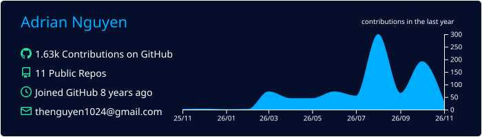
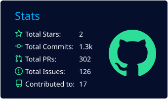
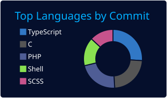

 

---

### 👋 About me

- I'm **Adrian Nguyen** (Nguyễn Đỗ Thế Nguyên), a backend engineer in Ho Chi Minh City, shipping production software since 2023 and leaning further into full-stack every year.
- At **Qualgo** I build Go microservices for payments and CRM – gRPC + grpc-gateway, PostgreSQL, Redis, River job queues, Stripe and OpenTelemetry – and the React front-ends on top of them.
- I like boring, well-tested services: an explicit domain model, decisions written down as ADRs, and CI that catches the mistake before a reviewer has to.
- Outside work I contribute upstream: mainline Linux for an old phone, an MCP server for Garmin data, and WireGuard / Tailscale on ESP32.

---

### 🧰 Tech I work with

**Backend**

**Data**

**Frontend**

**Infra & tooling**

**Side quests**

---

### 🛠️ Things I've built

**[Grimoire](https://github.com/fugo101/grimoire)** – a self-hosted expense tracker.
Next.js 16 (App Router) and React 19 with TanStack Query, Table, Form and Virtual, SQLite through Drizzle ORM, and
jose-signed sessions. Every transaction has two independent dimensions, *Purpose* and *Funding Source*, written up in a
domain glossary and ADRs. Hardened with a nonce-based CSP, login rate-limiting and a server that refuses to boot with a
weak secret; ships as a Docker image with a health check.

**[MicroLink](https://github.com/fugo101/microlink)** – a maintained fork of
[CamM2325/microlink](https://github.com/CamM2325/microlink), a Tailscale client for ESP32: the ts2021 control protocol,
WireGuard, DISCO path discovery and DERP relays in about 100 KB of SRAM. The fork moves it to ESP-IDF 6, swaps in our own
[wireguard-lwip](https://github.com/fugo101/wireguard-lwip) component (DERP/magicsock, multi-peer, upstream security
fixes) and keeps handshake timestamps across reboots.

**[active1-pmos](https://github.com/fudio101/active1-pmos)** – a postmarketOS port that turns a Vsmart Active 1
(Qualcomm SDM660) into a headless home server. The mainline kernel boots its own initramfs straight past the bootloader's
dm-verity; GPU, DSI panel, Wi-Fi, Bluetooth and charging all work. The device tree and panel driver are merged in
sdm660-mainline/linux, and the device package in postmarketOS pmaports.

**[LeagueKit](https://github.com/fugo101/LeagueKit)** – a no-build plugin suite for the League of Legends client
(Pengu Loader): auto-accept that survives flaky sockets (event observer + polling fallback + bounded retries), auto-honor
with preferred players, and leader-aware auto play-again, all configured from one English/Vietnamese dialog.

---

### 🌱 Open source

<!-- oss:start -->
- **[sdm660-mainline/linux](https://github.com/sdm660-mainline/linux/pulls?q=is%3Apr+author%3Afudio101+is%3Amerged)** – mainline Linux for Snapdragon 660 · **2 PRs merged**: Vsmart Active 1 board support, Himax HX83112A panel driver, touchscreen and SMB1351 charger
- **[postmarketOS/pmaports](https://gitlab.postmarketos.org/postmarketOS/pmaports/-/merge_requests/9720)** – **!9720 merged**: `device-vsmart-zangyapro` and its firmware package, plus a [device wiki page](https://wiki.postmarketos.org/wiki/Vsmart_Active_1_(vsmart-zangyapro))
- **[Taxuspt/garmin_mcp](https://github.com/Taxuspt/garmin_mcp/pulls?q=is%3Apr+author%3Afudio101)** – MCP server for Garmin Connect · ★ 1.5k · **1 merged**, 1 open
<!-- oss:end -->

---

### 📊 GitHub stats

  

  
  

<picture>
  <source media="(prefers-color-scheme: dark)" srcset="assets/snake/github-snake-dark.svg"/>
  <source media="(prefers-color-scheme: light)" srcset="assets/snake/github-snake.svg"/>
  
</picture>

